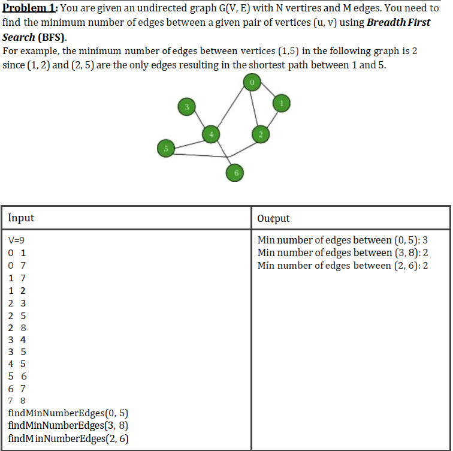
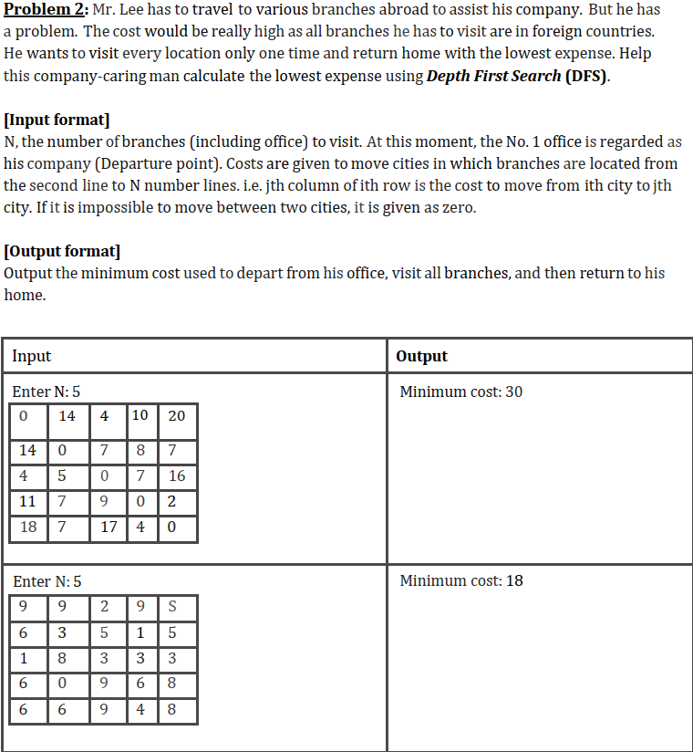
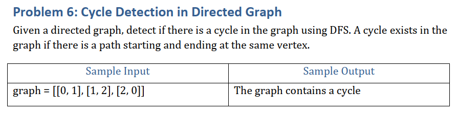
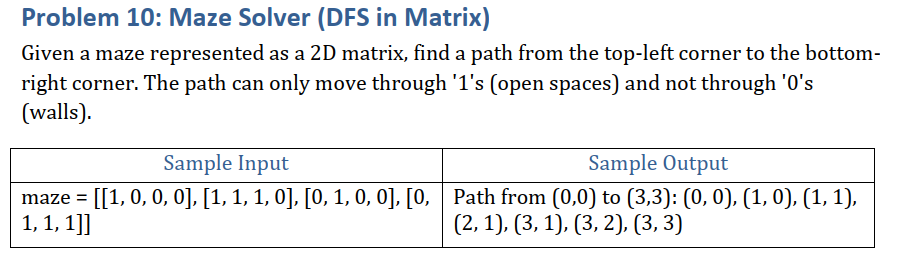
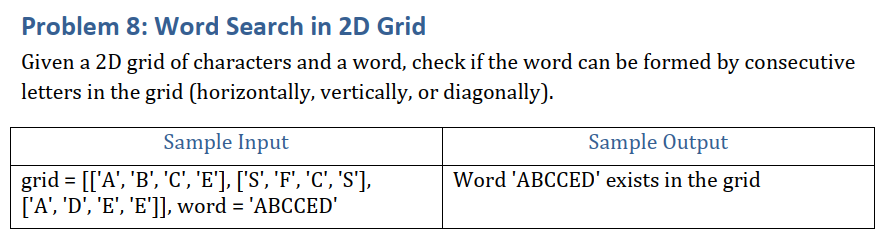
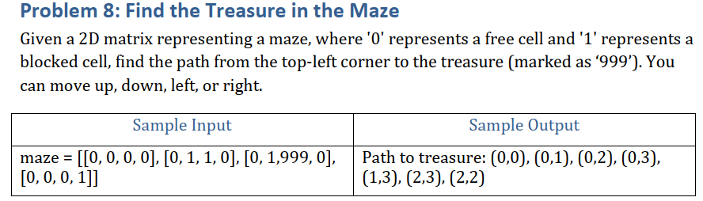
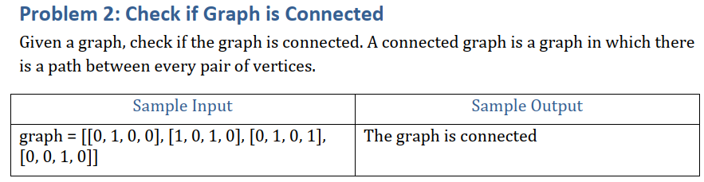
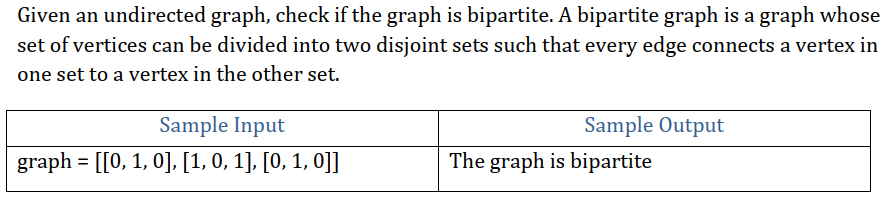

# Graphs Problems

## Number of Island

_problem link_: [LeetCode](https://leetcode.com/problems/number-of-islands/)

:::code-group

```c++ [BFS]
#include <iostream>
#include <vector>
#include <stack>
using namespace std;

void BFS(vector<vector<char>>& grid, int i, int j) {
    stack<pair<int, int>> ij;
    ij.push({i, j});
    grid[i][j] = '0';

    while (!ij.empty()) {
        pair<int, int> curr = ij.top();
        ij.pop();
        i = curr.first;
        j = curr.second;

        if (i - 1 > -1 && grid[i - 1][j] != '0') {
            ij.push({i - 1, j});
            grid[i - 1][j] = '0';
        }
        if (i + 1 < grid.size() && grid[i + 1][j] != '0') {
            ij.push({i + 1, j});
            grid[i + 1][j] = '0';
        }
        if (j - 1 > -1 && grid[i][j - 1] != '0') {
            ij.push({i, j - 1});
            grid[i][j - 1] = '0';
        }
        if (j + 1 < grid[0].size() && grid[i][j + 1] != '0') {
            ij.push({i, j + 1});
            grid[i][j + 1] = '0';
        }
    }
}

int numIslands(vector<vector<char>>& grid) {
    int total_island = 0;

    for (int i = 0; i < grid.size(); i++) {
        for (int j = 0; j < grid[0].size(); j++) {
            if (grid[i][j] == '1') {
                total_island++;
                BFS(grid, i, j);
            }
        }
    }

    return total_island;
}

int main() {
    vector<vector<char>> grid = {
        {'1', '1', '0', '0', '0'},
        {'1', '1', '0', '0', '0'},
        {'0', '0', '1', '0', '0'},
        {'0', '0', '0', '1', '1'}
    };

    int result = numIslands(grid);
    cout << result << endl;

    return 0;
}

```

```c++ [DFS]
#include <iostream>
#include <vector>

using namespace std;

void dfs(vector<vector<char>> &grid, int i , int j){

    //base case
    if(i<0 || i>grid.size()-1||j<0||j>grid[0].size()-1 || grid[i][j] != '1'){
        return;
    }

    //visited
    grid[i][j]='2';

    dfs(grid,i+1,j);
    dfs(grid,i-1,j);
    dfs(grid,i,j+1);
    dfs(grid,i,j-1);
}

int numIslands(vector<vector<char>>& grid) {
    int row = grid.size();
    int col = grid[0].size();
    int total_island = 0;

    for(int i=0; i<row; i++){
        for(int j=0; j<col; j++){
            if(grid[i][j] == '1'){
                total_island++;
                dfs(grid,i,j);
            }
        }
    }

    return total_island;
}

int main() {
    vector<vector<char>> grid = {
        {'1', '1', '0', '0', '0'},
        {'1', '1', '0', '0', '0'},
        {'0', '0', '1', '0', '0'},
        {'0', '0', '0', '1', '1'}
    };

    int result = numIslands(grid);
    cout<< result << endl;

    return 0;
}
```

:::

## Shortest Path


::: code-group

```c++ [BFS]
#include <bits/stdc++.h>
using namespace std;

int shortest_path(vector<vector<int>> adj, int V, int strt, int trgt)
{

    vector<int> dst(V, -1);
    queue<int> node;
    node.push(strt);
    dst[strt] = 0;
    while (!node.empty())
    {
        int curr = node.front();
        node.pop();

        if (curr == trgt)
        {
            return dst[curr];
        }

        for (auto v : adj[curr])
        {
            if (dst[v] == -1)
            {
                dst[v] = dst[curr] + 1;
                node.push(v);
            }
        }
    }
    return -1;
}

int main()
{
    int V, E;
    cin >> V >> E;
    vector<vector<int>> adj(V);

    for (int i = 0; i < E; i++)
    {
        int u, v;
        cin >> u >> v;

        adj[u].push_back(v);
        adj[v].push_back(u);
    }

    cout << "Min Number of Edges Between (0 , 5): " << shortest_path(adj, V, 0, 5) << endl;
    cout << "Min Number of Edges Between (3 , 8): " << shortest_path(adj, V, 3, 8) << endl;
    cout << "Min Number of Edges Between (2 , 6): " << shortest_path(adj, V, 2, 6) << endl;
}


```

```c++ [DFS]
#include<bits/stdc++.h>
using namespace std;

void dfs(
    vector<vector<int>>adj,
    vector<bool>&vis,
    int strt,
    int depth,
    int end,
    int &ans)
{
    if(strt == end){
        ans = min(depth,ans);
        return;
    }

    for(auto x: adj[strt]){
        if(!vis[x]){
            vis[x]= true;
            dfs(adj,vis,x,depth+1,end,ans);
            vis[x] = false;
        }
    }
}

int shortest_path(vector<vector<int>>adj,int V,int strt, int end){

    vector<bool> vis(V,false);
    int ans = INT_MAX;
    dfs(adj,vis,strt,0,end,ans);
    return (ans == INT_MAX)?-1:ans;
}


int main(){
    int V,E;
    cin>> V>> E;
    vector<vector<int>> adj(V);

for(int i =0;i<E;i++)
    {
        int u, v;
        cin>> u>> v;

        adj[u].push_back(v);
        adj[v].push_back(u);
    }

    cout << "Min Number of Edges Between (0 , 5): " << shortest_path(adj, V, 0, 5) << endl;
    cout << "Min Number of Edges Between (3 , 8): " << shortest_path(adj, V, 3, 8) << endl;
    cout << "Min Number of Edges Between (2 , 6): " << shortest_path(adj, V, 2, 6) << endl;

}

```

:::

::: code-group

```txt [Input 1]
9 13
0 1
0 7
1 7
1 2
2 3
2 5
2 8
3 4
3 5
4 5
5 6
6 7
7 8

```

<!-- ```txt [Input 1]
7 16
0 1
0 2
0 4
1 0
1 2
2 0
2 1
2 5
3 4
4 0
4 3
4 5
4 6
5 2
5 4
6 4
``` -->

:::

## Traveling Salesman



```c++ [DFS]
#include <bits/stdc++.h>
using namespace std;

void min_cost(
    const vector<vector<int>> &adj,
    vector<bool> &vis,
    int u,
    int all_vis,
    int current_cost,
    int &best_cost)
{
    //if current current_cost greater then best_cost, no need to go deeper
    if (current_cost >= best_cost)
        return;

    if (all_vis == adj.size())
    {
        if (adj[u][0] != 0)
        {
            best_cost = min(best_cost, current_cost + adj[u][0]);
        }
        return;
    }

    for (int v = 1; v < adj.size(); v++)
    {
        if (!vis[v] && adj[u][v] != 0)
        {
            vis[v] = true;
            min_cost(adj, vis, v, all_vis + 1, current_cost + adj[u][v], best_cost);
            vis[v] = false;
        }
    }
}

int main()
{
    int city;
    cin >> city;
    vector<vector<int>> adj(city, vector<int>(city));

    for (int i = 0; i < city; i++)
    {
        for (int j = 0; j < city; j++)
            cin >> adj[i][j];
    }

    int best_cost = INT_MAX;
    vector<bool> vis(city, false);

    vis[0] = true;
    min_cost(adj, vis, 0, 1, 0, best_cost);

    if (best_cost == INT_MAX)
        cout << -1;
    else
        cout << best_cost;

    return 0;
}

```

::: code-group

```txt [Input 1]
5
 0 14  4 10 20
14  0  7  8  7
 4  5  0  7 16
11  7  9  0  2
18  7 17  4  0

```

```txt[Input 2]
5
9 9 2 9 5
6 3 5 1 5
1 8 3 3 3
6 0 9 6 8
6 6 9 4 8

```

:::

## cycle detection


::: code-group

```c++ [DFS]
#include <bits/stdc++.h>
using namespace std;


void DFS(int i, int dst, int cnt, int &minimum, vector<vector<int>> &adjList, vector<bool> &vis)
{
    vis[i] = true;
    if (i == dst)
        minimum = min(minimum, cnt);

    for (auto neighbour : adjList[i])
    {
        if (!vis[neighbour])
        {
            DFS(neighbour, dst, cnt + 1, minimum, adjList, vis);
        }
    }
    vis[i] = false;
}

void shortestpath(vector<vector<int>> &adjList, int src, int dst, vector<int> &ans)
{
    int size = adjList.size();
    vector<bool> vis(size, false);
    int minimum = INT32_MAX;
    DFS(src, dst, 0, minimum, adjList, vis);
    ans.push_back(minimum);
}

int main()
{
    vector<vector<int>> adjMatrix = {
        {0, 1, 0, 0},
        {1, 0, 1, 0},
        {0, 1, 0, 1},
        {0, 0, 1, 0}};

    int row = adjMatrix.size();
    vector<vector<int>> adjList(row);

    for (int i = 0; i < row; i++)
    {
        for (int j = 0; j < row; j++)
        {
            if (adjMatrix[i][j] == 1)
                adjList[i].push_back(j);
        }
    }

    vector<int> ans;
    for (int i = 0; i < row; i++)
    {
        shortestpath(adjList, 0, i, ans);
    }
    cout << "shortest Path from 0:";
    for (auto x : ans)
        cout << x << " ";

    return 0;
}

```

```c++ [BFS]
#include <bits/stdc++.h>
using namespace std;

bool is_cycle_present(vector<vector<int>> &adjList)
{
    int size = adjList.size();
    vector<bool> vis(size + 1, false);
    vector<int> inDeg(size + 1, 0);

    for (auto x : adjList)
    {
        for (auto y : x)
        {
            inDeg[y]++;
        }
    }

    queue<int> q;
    for (int i = 0; i < size; i++)
    {
        if (inDeg[i] == 0)
            q.push(i);
    }
    int cnt = 0;
    while (!q.empty())
    {
        int front = q.front();
        q.pop();
        cnt++;
        for (auto neighobur : adjList[front])
        {
            inDeg[neighobur]--;
            if (inDeg[neighobur] == 0)
            {
                q.push(neighobur);
            }
        }
    }
    if (cnt != size)
        return true;
    else
        return false;
}
int main()
{
    vector<vector<int>> edges = {
        {0, 1},
        {1, 2},
        {2, 0}};

    int size = 0;
    for (auto &edge : edges)
        size = max(size, max(edge[0], edge[1]));

    vector<vector<int>> adjList(size + 1);
    for (auto &edge : edges)
    {
        int u = edge[0];
        int v = edge[1];
        adjList[u].push_back(v);
    }

    for (int i = 0; i < adjList.size(); i++)
    {
        cout << i << "-->";
        for (auto neighbour : adjList[i])
        {
            cout << neighbour << " ";
        }
        cout << endl;
    }

    if (hasCycle(adjList))
        cout << "cycle present\n";
    else
        cout << "cycle is not present\n";
    if (is_cycle_present(adjList))
        cout << "cycle present\n";
    else
        cout << "cycle is not present\n";
}

```

:::

## maze solver



```c++ [DFS]
#include <bits/stdc++.h>
using namespace std;

bool solve_maze(vector<vector<int>> &adjMat,
                int r,
                int c,
                vector<vector<bool>> &vis,
                pair<int, int> crnrIdx)
{

    if (r < 0 || c < 0 || r >= adjMat.size() || c >= adjMat[0].size() || vis[r][c] || adjMat[r][c] == 0)
    {
        return false;
    }
    if (r == crnrIdx.first && c == crnrIdx.second)
    {
        return true;
    }
    vis[r][c] = true;
    if (solve_maze(adjMat, r, c + 1, vis, crnrIdx) ||
        solve_maze(adjMat, r, c - 1, vis, crnrIdx) ||
        solve_maze(adjMat, r + 1, c, vis, crnrIdx) ||
        solve_maze(adjMat, r - 1, c, vis, crnrIdx))
    {
        return true;
    }
    vis[r][c] = false;
    return false;
}

int main()
{

    vector<vector<int>> adjMat = {
        {1, 0, 0, 0},
        {1, 1, 1, 0},
        {0, 1, 0, 0},
        {0, 1, 0, 1}};

    int r = adjMat.size();
    int c = adjMat[0].size();

    vector<vector<bool>> vis(r, vector<bool>(c, false));
    pair<int, int> crnrIdx = {3, 3};

    if (solve_maze(adjMat, 0, 0, vis, crnrIdx))
        cout << "maze solved\n";
    else
        cout << "maze couldn't solve\n";
    return 0;
}

```

## Word Search



```c++ [DFS]

#include <bits/stdc++.h>
using namespace std;

bool isMatched(string curr, string org)
{
    for (int i = 0; i < curr.size(); i++)
    {
        if (curr.size() > org.size())
            return false;
        if (curr[i] != org[i])
            return false;
    }
    return true;
}

string searchWord(vector<vector<char>> &adjMatrix, int i, int j, string curr, string org, vector<vector<bool>> &vis)
{

    if (i < 0 || j < 0 || i >= adjMatrix.size() || j >= adjMatrix[0].size() || vis[i][j] || curr == org)
    {
        return curr;
    }

    curr.push_back(adjMatrix[i][j]);

    if (!isMatched(curr, org))
    {
        curr.pop_back();
        return curr;
    }
    vis[i][j] = true;
    curr = searchWord(adjMatrix, i, j + 1, curr, org, vis);
    curr = searchWord(adjMatrix, i, j - 1, curr, org, vis);
    curr = searchWord(adjMatrix, i + 1, j, curr, org, vis);
    curr = searchWord(adjMatrix, i - 1, j, curr, org, vis);

    vis[i][j] = false;
    return curr;
}

int main()
{
    vector<vector<char>> adjMatrix = {
        {'A', 'B', 'C', 'E'},
        {'S', 'F', 'C', 'S'},
        {'A', 'D', 'E', 'E'}};

    // string word = "ABCCED";
    string word = "ASFDECSE";
    bool flag = false;
    int row = adjMatrix.size();
    int col = adjMatrix[0].size();
    vector<vector<bool>> vis(row, vector<bool>(col, false));

    for (int i = 0; i < adjMatrix.size(); i++)
    {
        for (int j = 0; j < adjMatrix[i].size(); j++)
        {
            string rc = searchWord(adjMatrix, i, j, "", word, vis);
            if (rc == word)
            {
                flag = true;
                break;
            }
        }
    }
    if (flag)
        cout << "Word " << word << " exists in the grid\n";
    else
        cout << "Word " << word << " does not exists in the grid\n";

    return 0;
}

```

## treasure in maze



```c++ [DFS]
#include <bits/stdc++.h>
using namespace std;

bool find_treasure(vector<vector<int>> &adjMatrix,
                   int r,
                   int c,
                   int curr,
                   int trgt,
                   vector<vector<bool>> &vis,
                   vector<pair<int, int>> &path)
{
    if (r < 0 || c < 0 || r >= adjMatrix.size() || c >= adjMatrix[0].size() || vis[r][c])
    {
        return false;
    }
    path.push_back({r, c});
    if (adjMatrix[r][c] == trgt)
    {
        return true;
    }

    vis[r][c] = true;
    if (find_treasure(adjMatrix, r, c + 1, curr, trgt, vis, path) ||
        find_treasure(adjMatrix, r, c - 1, curr, trgt, vis, path) ||
        find_treasure(adjMatrix, r + 1, c, curr, trgt, vis, path) ||
        find_treasure(adjMatrix, r - 1, c, curr, trgt, vis, path))
        return true;

    path.pop_back();
    vis[r][c] = false;
    return false;
}

int main()
{
    vector<vector<int>> adjMatrix = {
        {0, 0, 0, 0},
        {0, 1, 1, 0},
        {0, 1, 999, 0},
        {0, 0, 0, 1}};
    int r = adjMatrix.size();
    int c = adjMatrix[0].size();
    vector<vector<bool>> vis(r, vector<bool>(c, false));
    vector<pair<int, int>> path;

    bool flag = false;
    int trgt = 999;
    if (find_treasure(adjMatrix, 0, 0, adjMatrix[0][0], trgt, vis, path))
    {
        flag = true;
    }
    if (flag)
    {
        cout << "treasure found\n";
        for (auto x : path)
            cout << "(" << x.first << " , " << x.second << " )";
    }
    else
        cout << "treasure couldn't found\n";
    return 0;
}

```

## check if graph is connected



```c++ [DFS]

#include <bits/stdc++.h>
using namespace std;

void DFS(vector<vector<int>> &adjList, vector<bool> &vis, int node)
{
    vis[node] = true;
    for (auto neighbour : adjList[node])
    {
        if (!vis[neighbour])
        {
            DFS(adjList, vis, neighbour);
        }
    }
}

int main()
{
    vector<vector<int>> adjMat = {
        {0, 1, 0, 0},
        {1, 0, 1, 0},
        {0, 1, 0, 1},
        {0, 0, 1, 0}

    };
    int size = adjMat.size();
    vector<vector<int>> adjList(size);
    for (int i = 0; i < size; i++)
    {
        for (int j = 0; j < adjMat[i].size(); j++)
        {
            if (adjMat[i][j] == 1)
            {
                adjList[i].push_back(j);
            }
        }
    }

    vector<bool> vis(size, false);
    DFS(adjList, vis, 0);

    bool flag = false;
    for (int i = 0; i < size; i++)
    {
        if (!vis[i])
        {
            flag = true;
            break;
        }
    }
    if (flag)
        cout << "Graph is not connected\n";
    else
        cout << "Graph is connected\n";

    return 0;
}

```

## Bipartite Graph



```c++ [DFS]
#include <bits/stdc++.h>
using namespace std;

bool DFS(vector<vector<int>> &adjList, int node, int color, vector<int> &clrs)
{
    clrs[node] = color;

    for (auto neighbour : adjList[node])
    {
        if (clrs[neighbour] == -1)
        {
            if (!DFS(adjList, neighbour, !color, clrs))
                return false;
        }
        else if (clrs[neighbour] == color)
            return false;
    }
    return true;
}

int main()
{

    vector<vector<int>> adjMatrix = {
        {0, 1, 0, 0},
        {1, 0, 1, 1},
        {0, 1, 0, 1},
        {0, 1, 1, 0}};

    int row = adjMatrix.size();
    vector<vector<int>> adjList(row);

    for (int i = 0; i < row; i++)
    {
        for (int j = 0; j < adjMatrix[i].size(); j++)
        {
            if (adjMatrix[i][j] == 1)
                adjList[i].push_back(j);
        }
    }

    for (int i = 0; i < adjList.size(); i++)
    {
        cout << i << "-->";
        for (auto neighbour : adjList[i])
        {
            cout << neighbour << " ";
        }
        cout << endl;
    }

    vector<int> clrs(row + 1, -1);

    if (DFS(adjList, 0, 0, clrs))
        cout << "Bipartite\n";
    else
        cout << "Not Bipartite\n";

    return 0;
}

```

## all In One

```c++
#include <bits/stdc++.h>
using namespace std;

class Graph
{

public:
    vector<vector<int>> adjList;
    int V;
    int E;
    Graph(int V, int E)
    {
        this->V = V;
        this->E = E;
        adjList.resize(V + 1);
    }

    void addEdges(int u, int v)
    {
        adjList[u].push_back(v);
    }

    // NOTE::BFS TRAVERSAL
    //  considering Graph is not Connected
    void BFS()
    {
        vector<bool> visited(V + 1, false);
        queue<int> nodes;
        nodes.push(1);
        visited[1] = true;
        while (!nodes.empty())
        {
            int front = nodes.front();
            nodes.pop();

            cout << front << " ";
            for (auto neighbour : adjList[front])
            {
                if (!visited[neighbour])
                {
                    nodes.push(neighbour);
                    visited[neighbour] = true;
                }
            }
        }
    }
    // NOTE:: DFS TRAVERSAL

    void DFS()
    {
        vector<bool> vis(V + 1, false);
        for (int i = 1; i < V + 1; i++)
        {
            if (!vis[i])
                doDFS(i, vis);
        }
    }
    // NOTE:: CYCLE Detection
    void checkCycle()
    {
        vector<bool> ancestor(V + 1, false);
        vector<bool> vis(V + 1, false);
        for (int i = 1; i < V + 1; i++)
        {
            if (!vis[i])
            {
                bool cycle = cycleDFS(i, ancestor, vis);
                if (cycle)
                {
                    cout << "cycle Present\n";
                    return;
                }
            }
        }
        cout << "cycle not Present\n";
    }

    // NOTE:: Topo Sort Using DFS

    void topoSort()
    {
        vector<bool> vis(V + 1, false);
        stack<int> topoSeq;
        for (int i = 1; i <= V; i++)
        {
            if (!vis[i])
                topoDFS(i, vis, topoSeq);
        }

        while (!topoSeq.empty())
        {
            cout << topoSeq.top() << "  ";
            topoSeq.pop();
        }
    }

    // NOTE:: TOPO SORT USING BFS
    void topoSortBFS()
    {
        vector<bool> vis(V + 1, false);
        vector<int> inDeg(V + 1, 0);
        vector<int> topoSorted;

        for (auto x : adjList)
        {
            for (auto y : x)
            {
                inDeg[y]++;
            }
        }

        for (int i = 1; i <= V; i++)
        {
            if (!inDeg[i] && !vis[i])
            {
                topoBFS(i, vis, inDeg, topoSorted);
            }
        }

        for (auto x : topoSorted)
            cout << x << " ";
    }

    // NOTE:: Shortest Path
    void shortestPath(int src, int dst)
    {
        vector<int> parent(V + 1);
        parent[src] = -1;
        vector<bool> vis(V + 1, false);
        queue<int> nodes;
        nodes.push(src);
        while (!nodes.empty())
        {
            int front = nodes.front();
            nodes.pop();
            for (auto neighbour : adjList[front])
            {
                if (!vis[neighbour])
                {
                    vis[neighbour] = true;
                    parent[neighbour] = front;
                    nodes.push(neighbour);
                }
            }
        }
        int idx = dst;
        int pathLength = 0;
        while (parent[idx] != -1)
        {
            idx = parent[idx];
            pathLength++;
        }
        cout << "shortest path from: " << src << " to " << dst << " is: " << pathLength << endl;
    }

    void shortestPathBFS2(int src, int dst)
    {
        vector<int> distance(V + 1, -1);
        queue<int> q;

        // Start from node 1 (or adjust
        q.push(src);
        distance[src] = 0;

        while (!q.empty())
        {
            int current = q.front();
            q.pop();

            if (current == dst)
            {
                cout << "Shortest path: " << distance[current] << endl;
                return;
            }

            for (auto neighbor : adjList[current])
            {
                if (distance[neighbor] == -1)
                {
                    distance[neighbor] = distance[current] + 1;
                    q.push(neighbor);
                }
            }
        }

        cout << "No path found to " << dst << endl;
    }
    // NOTE:: SHortestPath Using DFS
    void shortestPathDFS(int src, int dst)
    {
        cout << "Printing Adjacency List:\n";
        for (int i = 1; i < adjList.size(); i++)
        {
            cout << i << ": ";
            for (int j = 0; j < adjList[i].size(); j++)
            {

                cout << adjList[i][j] << " ";
            }
            cout << endl;
        }

        vector<bool> vis(V + 1, false);
        int cnt = 0;
        int minimum = INT_MAX;
        shortestDFS(src, dst, vis, cnt, minimum);
        cout << "Shortest Distance is:\n";
        cout << minimum << endl;
    }

    void pathbfs(int s)
    {
        vector<bool> visited(V + 1, false);
        cout << s;
        queue<int> q;
        q.push(s);
        visited[s] = 1;

        while (!q.empty())
        {
            int v = q.front();
            q.pop();
            cout << v << " ";
            for (auto x : adjList[v])
            {
                if (!visited[x])
                {
                    q.push(x);
                    visited[x] = true;
                }
            }
        }
    }

private:
    void shortestDFS(int i, int dst, vector<bool> &vis, int cnt, int &minimum)
    {
        vis[i] = true;
        cout << "i'm in now this: " << i << " and cnt is: " << cnt << endl;
        if (dst == i)
        {
            cout << "Value found: " << i << " and cnt is: " << cnt << endl;
            minimum = min(minimum, cnt);
            vis[i] = false;
            return;
        }
        for (auto neighbour : adjList[i])
        {
            if (!vis[neighbour])
            {
                shortestDFS(neighbour, dst, vis, cnt + 1, minimum);
                vis[i] = false;
            }
        }
    }

    //  NOTE:: TOPOLOGICAL SORT USING BFS
    void topoBFS(int x, vector<bool> &vis, vector<int> &inDeg, vector<int> &topoSorted)
    {
        queue<int> nodes;
        nodes.push(x);
        vis[x] = true;
        topoSorted.push_back(x);

        while (!nodes.empty())
        {
            int front = nodes.front();
            nodes.pop();

            for (auto neighbour : adjList[front])
            {
                if (inDeg[neighbour] > 0)
                {
                    vis[neighbour] = true;
                    inDeg[neighbour]--;
                    if (inDeg[neighbour] == 0)
                    {
                        nodes.push(neighbour);
                        topoSorted.push_back(neighbour);
                    }
                }
            }
        }
    }

    // NOTE:: Topo Sort Using DFS
    void topoDFS(int node, vector<bool> &vis, stack<int> &topoSeq)
    {
        vis[node] = true;
        for (auto neighbour : adjList[node])
        {
            if (!vis[neighbour])
                topoDFS(neighbour, vis, topoSeq);
        }
        topoSeq.push(node);
    }

    // NOTE:: CYCLE Detection
    bool cycleDFS(int node, vector<bool> &ancestor, vector<bool> &vis)
    {
        vis[node] = true;
        ancestor[node] = true;
        for (auto neigbour : adjList[node])
        {
            if (!vis[neigbour])
            {
                bool isCycle = cycleDFS(neigbour, ancestor, vis);
                if (isCycle)
                    return true;
            }
            else if (ancestor[neigbour])
            {
                return true;
            }
        }
        ancestor[node] = false;
        return false;
    }

    // NOTE:: DFS Traversal
    void doDFS(int node, vector<bool> &vis)
    {
        vis[node] = true;
        cout << node << " ";
        for (auto neigbour : adjList[node])
            if (!vis[neigbour])
            {
                doDFS(neigbour, vis);
            }
    }
};

int main()
{
    int V, E;
    cin >> V >> E;
    Graph graph = Graph(V, E);
    while (E--)
    {
        int u, v;
        cin >> u >> v;
        graph.addEdges(u, v);
    }
    cout << "BFS Traversal\n";
    graph.BFS();
    cout << "\nDFS Traversal\n";
    graph.DFS();
    cout << "\nCycle Detection\n";
    graph.checkCycle();
    cout << "\nTopological Sort USING DFS:\n";
    graph.topoSort();
    cout << "\nTopological Sort USING BFS:\n";
    graph.topoSortBFS();
    cout << "\nEnter Source and Destination Node: ";
    int src, dst;
    cin >> src >> dst;
    graph.shortestPath(src, dst);
    cout << endl;
    graph.shortestPathDFS(src, dst);
    cout << "habijabei\n";
    graph.pathbfs(1);

    return 0;
}

/*

case 1: Directed Acyclic


case2:
7 8
1 2
2 3
3 4
3 5
4 5
4 7
5 6
6 3

case 3: for shortest path
7 8
1 2
1 3
1 5
2 3
3 6
5 4
5 7
6 7

src = 1 -> dst = 7. Expected Ans= 2

*/

```
